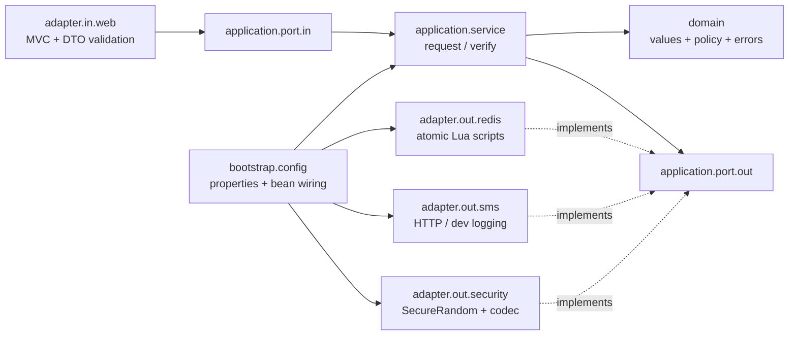

# OTP Service

Java 21, Spring Boot 3.5.16, Maven, Spring MVC on virtual threads, and Redis. Redis is the only OTP store. No Lombok is used.

The base package is `ir.maziyar_gerami.otp`, with matching source directories under `src/main/java/ir/maziyar_gerami/otp` and `src/test/java/ir/maziyar_gerami/otp`. The underscore replaces the hyphen in the owner name because Java package identifiers cannot contain hyphens.

## Architecture



The domain and application contain no Spring imports. Adapters do not depend on other adapters. Bootstrap owns composition. ArchUnit enforces these rules.

A request atomically reserves cooldown and charges a fixed-window rate limit. It generates a numeric code (leading zeros are preserved), saves a versioned Redis hash with TTL, then sends SMS in production. In development, the application bypasses the SMS sender and returns the exact code in the response. A new issuance replaces the previous hash and resets attempts. Saving requires ownership of the reservation, protecting against delayed requests.

Verification reads a snapshot, compares the code using Java's `MessageDigest.isEqual`, then applies the result with a Lua compare-and-set on the issuance version and attempt counter. Redis checks existence again inside the script. Correct verification deletes immediately; concurrent correct verifications have exactly one winner. Incorrect verification increments atomically without extending TTL and deletes at the attempt limit. Stale snapshots trigger bounded retries and a fresh comparison.

SMS failure removes only the failing request's version and cooldown. Its rate-limit charge remains to prevent provider failures from allowing unlimited requests. A provider timeout has an ambiguous delivery outcome: an SMS may arrive containing a code already invalidated by cleanup. Redis cleanup during an outage is best effort, with TTL providing eventual expiry.

Keys use `<prefix>{<E.164 phone>}:code|cooldown|rate`; the hash tag keeps related keys in one Redis Cluster slot. The application uses a single Redis endpoint by default. OTP values and phone numbers in keys are sensitive: restrict Redis access, configure TLS in deployment where needed, and avoid persistence/backups for this ephemeral store. Compose disables persistence.

## Run locally

Prerequisites: Java 21, Maven 3.8.7+, Docker with permission to access its daemon.

For running the app on the host, start a local Redis bound to loopback:

```sh
docker run --name otp-local-redis --rm -p 127.0.0.1:6379:6379 redis:7.4-alpine
SPRING_PROFILES_ACTIVE=dev mvn spring-boot:run
```

In `dev`, OTP request responses include the exact generated `code`; the SMS sender is not called and no SMS credentials are required. Redis storage, TTL, cooldown, rate limits, and verification still work normally. Never enable `dev` on a production deployment. Activating `prod` together with `dev` selects HTTP SMS and omits the code from responses. A logging sender remains available in development wiring but is bypassed by the request use case.

## Docker Compose

```sh
cp .env.example .env
# Edit .env and replace REDIS_PASSWORD.
docker compose up --build -d
docker compose logs -f app
curl http://localhost:8080/actuator/health
docker compose down
```

Compose defaults to `dev` for an immediately usable demo. The Docker image and application default to `prod`. The image uses a Java 21 JRE and UID/GID 10001, graceful shutdown, and a read-only filesystem in Compose.

For production, set `SPRING_PROFILES_ACTIVE=prod`, `SMS_BASE_URL` to the provider HTTPS URL, and `SMS_API_KEY` to a secret. Deploy behind TLS and restrict Actuator and documentation endpoints at the ingress/network boundary. Phone-based limits do not replace network-wide abuse controls; the endpoints themselves are intentionally unauthenticated.

## Configuration

Configuration is in `application.yml`, bound and validated with immutable `@ConfigurationProperties`. Redis settings use Spring Boot's Redis properties. Environment overrides:

| Setting | Environment variable | Default |
| --- | --- | --- |
| OTP length | OTP_CODE_LENGTH | 6 |
| Per-request length override | JSON request field codeLength | optional, uses OTP_CODE_LENGTH |
| OTP lifetime | OTP_TTL | 120s |
| Verification attempt limit | OTP_MAX_VERIFY_ATTEMPTS | 3 |
| Resend cooldown | OTP_RESEND_COOLDOWN | 60s |
| Fixed-window request limit | OTP_RATE_LIMIT_MAX_REQUESTS | 3 |
| Rate-limit window | OTP_RATE_LIMIT_WINDOW | 10m |
| Redis key prefix | OTP_KEY_PREFIX | otp: |
| Redis host | REDIS_HOST | localhost |
| Redis port | REDIS_PORT | 6379 |
| Redis password | REDIS_PASSWORD | empty locally; required by Compose |
| Redis connect timeout | REDIS_CONNECT_TIMEOUT | 2s |
| Redis command timeout | REDIS_TIMEOUT | 2s |
| SMS base URL | SMS_BASE_URL | http://localhost:9090 |
| SMS send path | SMS_SEND_PATH | /messages |
| SMS bearer token | SMS_API_KEY | required outside dev |
| SMS connect timeout | SMS_CONNECT_TIMEOUT | 2s |
| SMS response timeout | SMS_READ_TIMEOUT | 5s |
| Server port | SERVER_PORT | 8080 |
| Active profiles | SPRING_PROFILES_ACTIVE | prod (dev in Compose) |
| OpenAPI and Swagger enabled | OPENAPI_ENABLED | true |

OTP length: 4–10 ASCII digits. Attempt limit: 1–100. Request limit: 1–10000. OTP durations: whole seconds, from 1 second through 7 days. SMS timeouts: 1ms–30s. Prefixes allow ASCII letters, numbers, colon, underscore, and hyphen. Invalid configuration fails startup. Every listed setting also accepts its native Spring property environment form. For additional Spring Redis options (including TLS), use standard `SPRING_DATA_REDIS_*` properties.

The `Clock` is injected for issuance timestamps; Redis owns expiry and rate-limit time. Tests fix the application clock and use real Redis TTLs with bounded polling.

## API

Request an OTP:

```sh
curl -i -X POST http://localhost:8080/api/v1/otp/request \
  -H 'Content-Type: application/json' \
  -d '{"phoneNumber":"+989121234567","codeLength":8}'
```

HTTP 200 in production (the code field is omitted, not returned as null):

```json
{"expiresInSeconds":120,"resendAvailableInSeconds":60}
```

HTTP 200 in development:

```json
{"expiresInSeconds":120,"resendAvailableInSeconds":60,"code":"00123456"}
```

The optional integer `codeLength` accepts 4–10. Omitting it or sending null uses the configured `otp.code-length` default, which is **6 digits** out of the box. For example, `{"phoneNumber":"+989121234567"}` generates a six-digit OTP with the default configuration. Each OTP stores its chosen length in Redis, so verification works even when the requested length differs from the global default. Both request responses include `Cache-Control: no-store`. The development code is a string and preserves leading zeros; it is returned only after successful Redis storage.

Verify using the SMS code (or the code returned in the development response):

```sh
curl -i -X POST http://localhost:8080/api/v1/otp/verify \
  -H 'Content-Type: application/json' \
  -d '{"phoneNumber":"+989121234567","code":"00123456"}'
```

HTTP 200:

```json
{"verified":true}
```

E.164 validation accepts a leading `+`, a nonzero first digit, and 2–15 total ASCII digits. It checks syntax, not whether a number exists. Verification codes must match the length stored with the issued OTP; malformed input does not consume verification attempts. Fractional or out-of-range request lengths return `VALIDATION_ERROR`. Unknown JSON fields are rejected. Existing plaintext Redis OTP entries without length metadata remain readable until expiry. Issuance timing is the configured validity period, counted from Redis storage; SMS delivery time reduces the remaining lifetime.

Failures use RFC 7807 `application/problem+json`:

```json
{
  "type":"urn:otp:error:OTP_COOLDOWN_ACTIVE",
  "title":"OTP_COOLDOWN_ACTIVE",
  "status":429,
  "detail":"Wait before requesting another OTP.",
  "instance":"/api/v1/otp/request",
  "code":"OTP_COOLDOWN_ACTIVE"
}
```

| Code | HTTP status |
| --- | --- |
| VALIDATION_ERROR | 400 |
| OTP_NOT_FOUND_OR_EXPIRED | 400 |
| OTP_INVALID | 400 |
| OTP_ATTEMPTS_EXCEEDED | 400 |
| OTP_RATE_LIMITED | 429 |
| OTP_COOLDOWN_ACTIVE | 429 |
| OTP_DELIVERY_FAILED | 503 |
| OTP_SERVICE_UNAVAILABLE | 503 (500 for unexpected internal errors) |

Both 429 errors include a `Retry-After` header in whole seconds, rounded up. Cooldown is checked before the request-window limit and survives successful verification. Failed code verification does not change the request-rate counter. Error responses use `Cache-Control: no-store` and do not echo phone numbers, codes, provider bodies, or internal exceptions.

Swagger UI: `/swagger-ui/index.html`. OpenAPI JSON: `/v3/api-docs`.

## SMS adapter contract

The HTTP adapter posts to `SMS_BASE_URL` + `SMS_SEND_PATH`:

```http
POST /messages
Authorization: Bearer <SMS_API_KEY>
Content-Type: application/json
```

```json
{"phoneNumber":"+989121234567","code":"123456","expiresInSeconds":120}
```

A 2xx response means accepted delivery. HTTP errors and timeouts map to `OTP_DELIVERY_FAILED`. There are no automatic retries, preventing duplicate SMS sends. Adapt provider-specific payloads and authentication by implementing `OtpSenderPort` and changing bootstrap wiring; application and domain stay unchanged.

Codes are currently plain text in Redis. `OtpCodec` encapsulates encoding and comparison; a future keyed HMAC codec can replace the implementation through wiring without changing use cases. Production SMS logs include only delivery status and a masked phone. JSON structured logs use Spring Boot's Logstash format. Do not enable request-body, HTTP wire, Redis command, or debug logging in production.

## Operations

Actuator exposes `/actuator/health`, `/actuator/info`, and `/actuator/metrics`. Readiness at `/actuator/health/readiness` includes Redis; liveness is separate. Health details are not publicly disclosed. Metrics include JVM, HTTP, Redis client, and runtime meters provided by Spring Boot. Redis outages map to sanitized 503 responses.

## Tests and coverage

```sh
mvn clean verify
```

Docker is required: integration tests always use real Testcontainers Redis and fail if Docker is unavailable. Tests are not silently skipped. Surefire runs `*Test`; Failsafe runs `*IT`. JaCoCo combines both phases and enforces at least 80% total line coverage in `verify`. Report: `target/site/jacoco/index.html`.

```sh
mvn test                         # Unit, MVC, SMS, configuration, architecture
mvn verify                       # All tests, package, coverage gate
mvn -DskipTests package           # Package only; not a release validation
```

Tests cover domain invariants, use cases with Mockito ports, MockMvc errors and headers, SMS payloads and failures with MockWebServer, real Redis expiry/replacement/attempt counters, concurrent admissions and verification, and full request → SMS → verify flows. Production end-to-end tests use the HTTP sender against a stub SMS server and assert that codes are absent from responses. Development end-to-end tests verify the exact returned code, configured length, leading zeros, single use, cooldown, and zero SMS calls. Profile tests ensure production takes precedence when both dev and prod are active.

The original standalone `src/Main.java` starter is preserved. Maven and IntelliJ use `src/main/java` and `src/test/java` as Java source roots. Import or reload `pom.xml` in IntelliJ to resolve Maven dependencies.

Dependency references: [Spring Boot releases on Maven Central](https://repo.maven.apache.org/maven2/org/springframework/boot/spring-boot-starter-parent/maven-metadata.xml), [springdoc compatibility](https://springdoc.org/).
